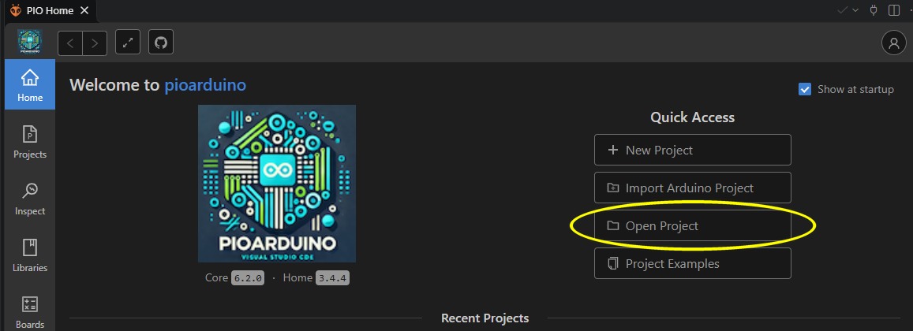

# Abrantix Ax2WDRobot Programming

## Overview

The Ax2WDRobot is based on espressif's ESP32. The provided firmware uses arduino-esp32 toolchain for unified Arduino-Style programming.
For firmware development, Visual Studio Code in conjunction with platformio extension are the recommended tools.

## IDE Installation

1. Navigate to https://code.visualstudio.com/download to download and install Visual Studio Code 
   
2. Start Visual Studio Code and open *Extensions*
   
   

3. In the Extensions screen, search for *platformio* and install it. After installation VS Code has to be restarted.

   

4. Now, you should have a platformio icon in the left toolbar - click on it

   

5. In the platformio Home menu, click on *Open project*

   

6. Navigate to the folder where you cloned the github project from and open *Ax2WDRobot/firmware/Ax2WDRobot* and click *Open Firmware*.
 
   

### Driver installation
The *Ax2WDRobot* uses a Silicon Labs CP210X USB to UART Bridge for communication between PC and robot. Depending on given OS, this driver is already built-in, could be provided as optional Update package or has to be manually installed. In case of a manual installation, please refer to https://www.silabs.com/developers/usb-to-uart-bridge-vcp-drivers?tab=downloads

## Build and upload the firmware
After opening the platformio project, the status bar got some additional icons.
To build, just press the *Check* icon

To upload, first connect the *Ax2WDRobot* to the PC and turn it on. Then, press the *right arrow* icon to build and upload the firmware.

